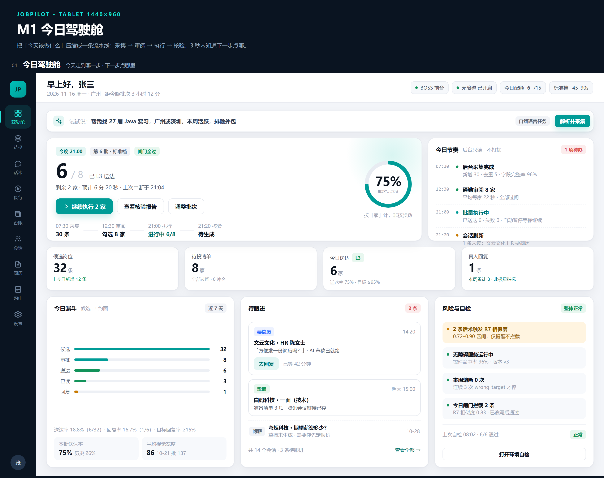
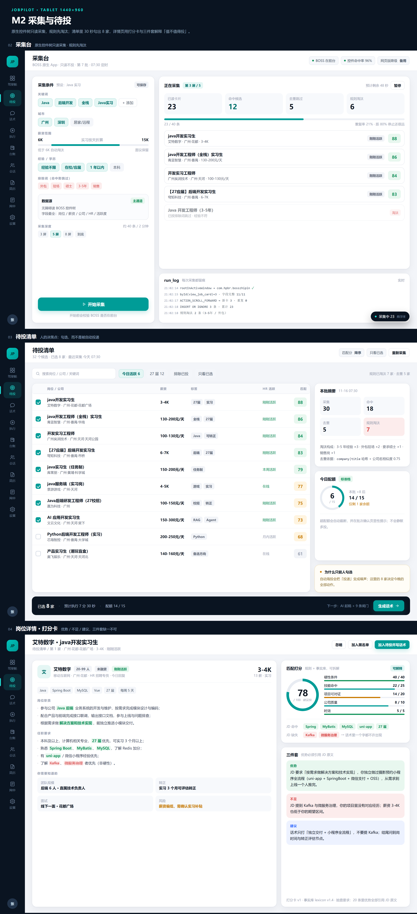
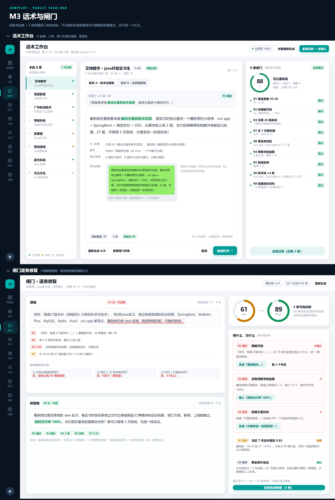
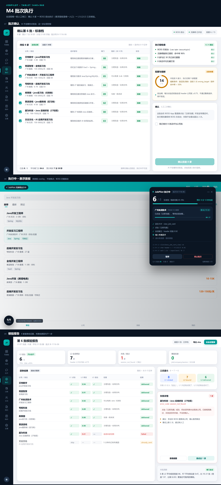
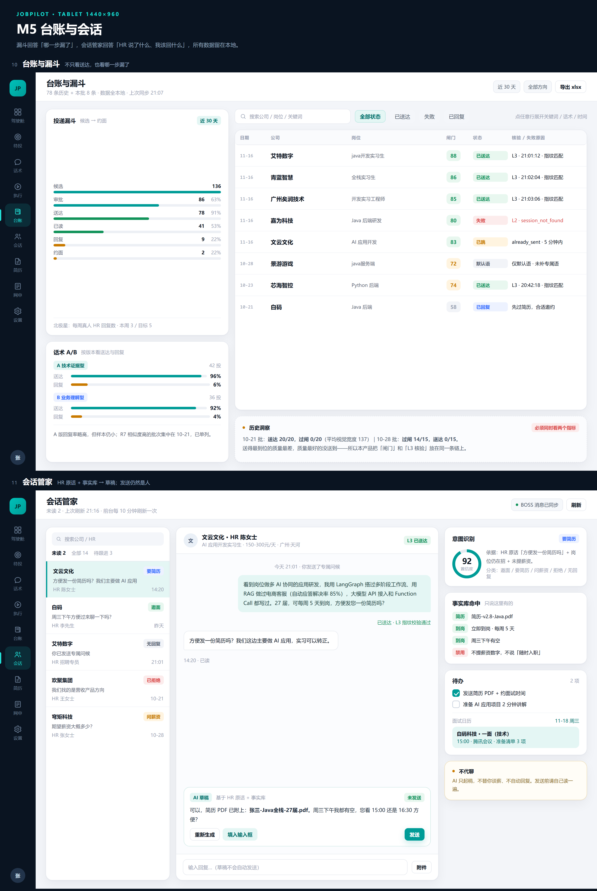
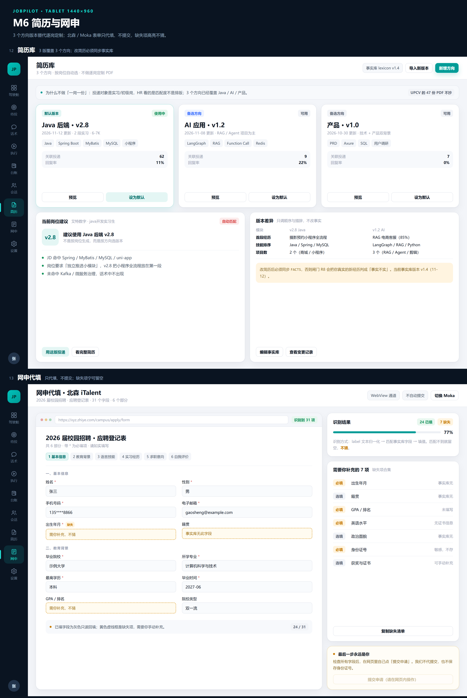
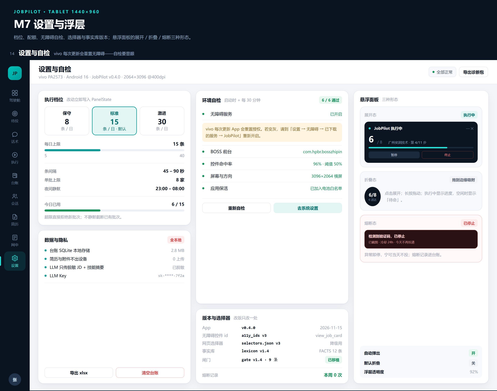

# JobPilot · BOSS 投递驾驶舱

> 一个跑在 Android 平板上的求职副驾：**人做决策，AI 做劳务，机器做执行，数据全留本地。**

JobPilot 不是海投脚本。它把「今天该投哪几家、为什么投、投得怎么样」压缩成一条日节奏流水线：

```
采集 → 打分 · 审阅 → 人勾选 → 话术 + 9 条闸门 → 确认 → 接管 BOSS 执行 → 三态核验 → 台账/会话
```

主界面是平板横屏的 7 个模块、14 个界面（设计稿 1440×960），执行期因为 BOSS 必须在前台，
所有进度与操作收敛到一块**常驻悬浮面板**上。

- 平台：Android 8.0+（实测 vivo PA2573 / Android 16 / 3096×2064 / 400dpi）
- 技术：Kotlin · Jetpack Compose · AccessibilityService · SQLite · TYPE_APPLICATION_OVERLAY
- 版本：v0.4.0（versionCode 4）
- 数据：本地 SQLite，无账号、无云同步

---

## 目录

- [为什么做这个](#为什么做这个)
- [原型预览](#原型预览)
- [核心设计（5 条不妥协）](#核心设计5-条不妥协)
- [功能模块与进度](#功能模块与进度)
- [技术架构](#技术架构)
- [目录结构](#目录结构)
- [构建与安装](#构建与安装)
- [首次使用流程](#首次使用流程)
- [数据与隐私](#数据与隐私)
- [Roadmap](#roadmap)
- [文档索引](#文档索引)

---

## 为什么做这个

复盘 78 条历史投递话术时，发现了两个刺眼的事实：

> `10-21` 那批是唯一 **100% 核验送达**的，但过闸率 **0/20**，平均视觉宽度 **137**（上限 95）；
> `10-28` 那批平均宽度 **63**、过闸 14/15，却大量停在「默认语已发」。
>
> **送得最到位的那批质量最差，质量最好的那批没送到。**

于是有了 JobPilot 的三个基本判断：

1. **投递不是越多越好**：一天认真投 8 家，比群发 80 家更接近面试。
2. **质量必须可解释**：分数、优势、不足、建议、JD 命中词，缺一不可。
3. **自动化的边界要写进界面**：哪些是 AI 建议、哪一步必须人按、失败为什么停，全部显性展示。

---

## 原型预览

> 高保真原型（可交互 HTML）在 [`2026-11-16/tablet-feature-design/outputs/index.html`](2026-11-16/tablet-feature-design/outputs/index.html)，
> 设计说明见 [`02-平板端功能设计-v1.0.md`](2026-11-16/tablet-feature-design/outputs/02-平板端功能设计-v1.0.md)。

### M1 今日驾驶舱

一天走到哪一步、下一步点什么。今日进度、待办、漏斗、待跟进、风险自检一屏收齐。



### M2 采集与待投

原生控件树只读采集，规则先淘汰；人在清单上 30 秒勾出 8 家，去重、配额、匹配分同时可见。



### M3 话术与闸门

一条一版，不套模板；发送前逐条过 9 条闸门，硬拦红线、软扣分给建议，分数可拆解。



### M4 批次执行

批次确认 → 悬浮面板执行 → 三态核验报告。每条之间随机间隔，异常即停，已投的照常记账。



### M5 台账与会话

漏斗 + 台账明细 + 会话管家：只起稿、不代聊，真人回复才是北极星指标。



### M6 简历与网申

按方向管理 3 个简历版本；网申页只识别、不猜，缺失项高亮交给人补。



### M7 设置与浮层

执行档位、每日上限、间隔、夜间静默、无障碍自检、数据与隐私、悬浮面板三种形态。



---

## 核心设计（5 条不妥协）

| # | 原则 | 落地方式 |
|---|---|---|
| 1 | **人勾选，不自动海投** | 待投清单手动勾选；批次必须二次确认；超额自动截断并显性提示 |
| 2 | **话术一条一版** | `GreetingGen` 按「简历 ∩ 岗位 JD」生成，引用 JD 具体词，禁止模板开场 |
| 3 | **9 条闸门前置** | 硬规则守底线（宽度/模板/JD 引用/事实库/相似度），软规则给建议，不因太严被关掉 |
| 4 | **只有 L3 才算送达** | L1 点到按钮 / L2 进会话 / L3 文本指纹核验；台账按真实送达统计 |
| 5 | **安全阀写进界面** | 日上限、45–120s 随机间隔、23:00–08:00 夜间静默、连续 3 次未送达熔断 |

> 风险红线：不伪造设备指纹、不多账号、不自动回复聊天、不做全自动发送。

---

## 功能模块与进度

| 模块 | 界面 | 状态 | 说明 |
|---|---|---|---|
| M1 今日驾驶舱 | 首页 | ✅ 已实现 | 今日批次进度、节奏时间线、漏斗、最近投递、风险自检 |
| M2 采集台 | 悬浮面板 / 采集入口 | ✅ 已实现 | 无障碍读 BOSS 卡片、字段完整度、去重入库 |
| M2 待投清单 | 左侧「清单」 | ✅ 已实现 | 搜索/筛选/排序、批量勾选、批次摘要、今日配额 |
| M2 岗位详情 · 打分卡 | 详情 | 🚧 进行中 | 当前分数与三件套已入库，详情页待接 |
| M3 话术工作台 | 左侧「话术」 | 🚧 进行中 | 生成器与闸门已可用，独立编辑/修复界面待做 |
| M4 批次执行 | 悬浮面板 | ✅ 已实现 | 暂停/继续/停止、单条 11 步、熔断、L1/L2/L3 |
| M5 台账与会话 | 左侧「台账」 | 🚧 规划中 | 台账数据与 CSV 导出已就绪，看板/会话界面待做 |
| M6 简历与网申 | 设置 · 简历 | 🚧 部分 | 简历读取/版本/评分已接，网申代填待做 |
| M7 设置与自检 | 左侧「设置」 | ✅ 已实现 | 档位、配额、间隔、夜间静默、无障碍自检、数据与隐私 |

---

## 技术架构

```
┌──────────────────────────── Android 平板 ────────────────────────────┐
│  Compose 界面层                                                        │
│    HomeActivity（驾驶舱）  CockpitActivity（待投）  StubActivity（设置等）│
│    NavRail 共享导航 · 统一设计系统（F4F6FA 底 / 白卡 / 16dp 圆角）        │
├──────────────────────────────────────────────────────────────────────┤
│  执行层                                                                │
│    AppAbstractor / AppExecutor · BatchRunner · Safety · Gate · Scorer   │
│    三态核验（L1/L2/L3） · 冷却与熔断 · 随机间隔                          │
├──────────────────────────────────────────────────────────────────────┤
│  通道层                                                                │
│    主通道：AccessibilityService 读/点 BOSS 原生控件树                    │
│    降级：WebView 桌面 UA + probe/selectors.json                        │
│    悬浮：TYPE_APPLICATION_OVERLAY（执行期唯一可见界面）                  │
├──────────────────────────────────────────────────────────────────────┤
│  数据层                                                                │
│    SQLite：job / score / greeting / application / company / run_log    │
│    去重：company|title 哈希 + 公司名归一化 0.75 + 黑名单                 │
└──────────────────────────────────────────────────────────────────────┘
```

关键取舍：

- **只做单端平板**：多人多端会引入账号与同步成本，而 BOSS 本身已登录。
- **主通道不是浏览器自动化**：无障碍读原生控件树字段最全，也更接近真人操作。
- **LLM 只做辅助**：只传 JD + 技能摘要，不传整份简历；离线也能用规则打分跑通。

---

## 目录结构

```
jobpilot/
├── app-shell/                     # Android App（Kotlin + Compose）
│   └── app/src/main/java/com/jobpilot/pad/
│       ├── HomeActivity.kt        # M1 今日驾驶舱
│       ├── CockpitActivity.kt     # M2 待投清单 + 单条/批量投递
│       ├── StubActivity.kt        # 话术/台账占位 + M7 设置与自检
│       ├── FloatingPanel.kt       # M4 执行期悬浮面板
│       ├── PanelState.kt          # 面板与执行器共享的运行时状态
│       ├── collect/               # 采集：控件树 / WebView 降级
│       ├── exec/                  # 执行：路由、批次、闸门、打分、话术、安全阀
│       ├── data/                  # SQLite、去重键、模型
│       └── ui/                    # NavRail 等共享 UI
├── gate/                          # 9 条话术闸门（Python 参考实现 + 词表/事实库）
├── probe/                         # WebView 降级选择器 + 自检脚本
├── docs/                          # M0 验证、环境记录、进度对照
├── 2026-11-16/tablet-feature-design/
│   └── outputs/                   # 平板端功能设计文档 + 高保真原型 + 原型长图
└── README.md
```

---

## 构建与安装

环境：JDK 17、Android SDK 34、Gradle 8.7（仓库不带 wrapper）。

```powershell
cd app-shell
& "D:\Android\gradle-8.7\bin\gradle.bat" :app:assembleDebug --console=plain
adb install -r app\build\outputs\apk\debug\app-debug.apk
```

安装后首次启动需要：

1. 打开「设置 → 无障碍」，启用 **JobPilot 采集服务**（每次重装会被系统重置，需要重新开启）；
2. Android 13+ 允许悬浮窗权限；
3. 可选：在设置里填 DeepSeek / OpenAI 兼容的 API Key，启用 LLM 精算。

> 构建参数：`compileSdk 34` / `minSdk 26` / `targetSdk 34` / `versionName 0.4.0`。

---

## 首次使用流程

1. **登录 BOSS**：打开 App 内的 BOSS 入口（或直接切到 BOSS App），停在职位列表页。
2. **采集**：点左下「采集」或首页「去采集」，在悬浮面板上开始采集；只读，不投递。
3. **审阅**：回到「清单」，按匹配分排序，搜索/筛选后勾选今天要投的 8 家。
4. **试跑**：先点「试跑」，确认话术与闸门结果，不会真的发送。
5. **投递**：点「批量投递」，二次确认后由悬浮面板逐条执行；可随时暂停/停止。
6. **复盘**：首页看今日节奏与最近投递；设置页可导出台账 CSV。

---

## 数据与隐私

- 岗位、评分、话术、投递记录全部存在本机 SQLite（`jobpilot.db`）。
- 简历只在本机读取；调用 LLM 时仅发送「JD 片段 + 技能摘要」，不发送联系方式等个人信息。
- 无账号体系、无云端同步、无埋点上报。
- 台账可导出 CSV；「清空台账」只删投递记录，不动岗位清单。
- 仓库不包含任何真实简历、API Key 或投递记录（见 `.gitignore`）。

---

## Roadmap

- [x] 悬浮面板 + 批次执行 + 三态核验 + 熔断
- [x] 采集（无障碍控件树）+ 去重入库
- [x] 规则打分 / LLM 精算 / 话术生成 / 9 条闸门
- [x] M1 今日驾驶舱、M2 待投清单、M7 设置与自检
- [ ] M2 岗位详情 · 打分卡（JD 原文高亮 + 五维明细）
- [ ] M3 话术工作台（双版本、逐条修复、实时分数）
- [ ] M5 台账看板 + 会话管家（只起稿不代聊）
- [ ] M6 网申代填（识别、不猜、缺失项高亮）
- [ ] 定时采集与「一句话找岗」解析

---

## 文档索引

| 文档 | 内容 |
|---|---|
| [`02-平板端功能设计-v1.0.md`](2026-11-16/tablet-feature-design/outputs/02-平板端功能设计-v1.0.md) | 7 模块 / 14 屏的完整功能设计 |
| [`01-标杆拆解-UPCV.md`](2026-11-16/tablet-feature-design/outputs/01-标杆拆解-UPCV.md) | UPCV 能力拆解与平板映射依据 |
| [`docs/M0-平板验证手册.md`](docs/M0-平板验证手册.md) | 真机验证步骤与结论 |
| [`docs/进度对照-PRD-v1.1.md`](docs/进度对照-PRD-v1.1.md) | PRD 里程碑对照 |
| [`gate/`](gate) | 9 条闸门的规则、词表与历史体检脚本 |

---

## 边界与免责声明

本项目是**个人自用的半自动求职工具**，不是爬虫或群发器：

- 不伪造设备指纹、不绕过风控、不多账号；
- 不做全自动投递，每一批都需要人确认；
- 不自动回复聊天，只提供草稿；
- 使用前请自行确认符合平台规则与当地法律法规，风险自担。
